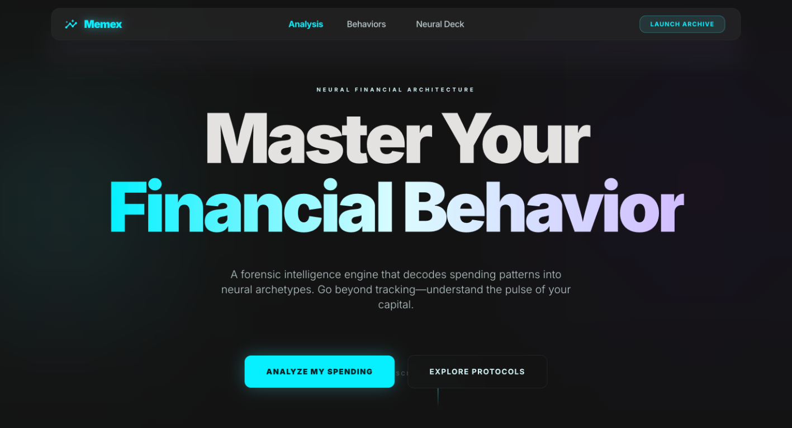
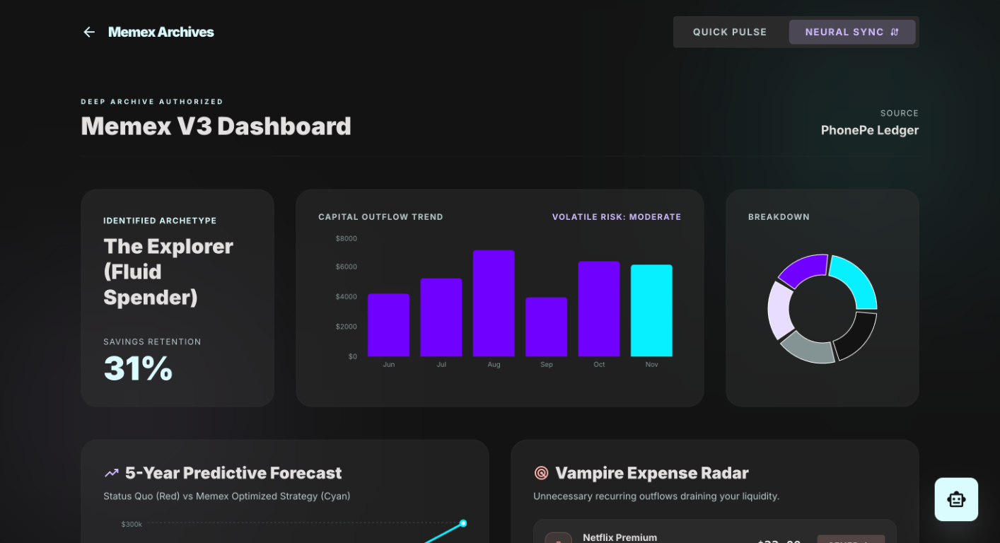
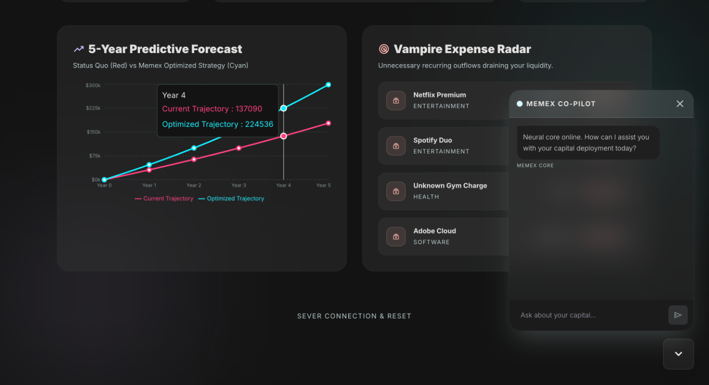
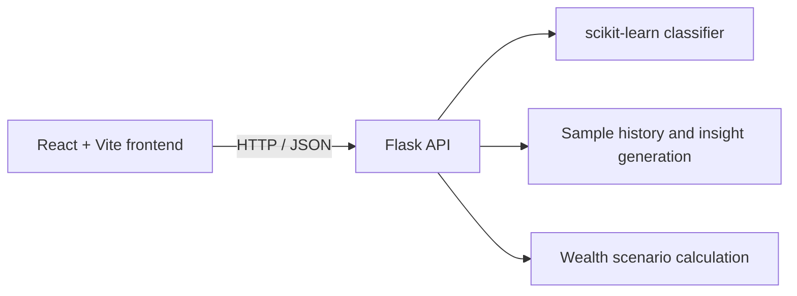

<div align="center">
  <h1>Memex</h1>
  <p><strong>A behavioral finance dashboard for exploring spending patterns and savings scenarios.</strong></p>
  <p>
    
    
    
  </p>
</div>

Memex is a full-stack finance prototype that pairs a React dashboard with a Flask API. It presents spending patterns, savings scenarios, and recurring-expense examples in a single interface. Account connections and historical transaction data are simulated; the app does not connect to a bank or provide financial advice.

## Product preview

| Landing page | Archive dashboard |
| --- | --- |
|  |  |



## Features

- **Spending risk classification:** Uses a scikit-learn model to classify a transaction from its expense-to-income ratio, category, and day of week.
- **Spending history dashboard:** Generates a six-month sample history with category totals, a savings-rate estimate, and a spending archetype.
- **Wealth scenarios:** Compares illustrative five-year savings projections using different monthly savings and return assumptions.
- **Recurring-expense examples:** Shows sample recurring charges that can be removed from the demo view.
- **In-app co-pilot:** Provides scripted responses to a small set of finance-related prompts.

## Technology

- **Frontend:** React, TypeScript, Vite, React Router, Recharts, and Framer Motion
- **Backend:** Python, Flask, Flask-CORS, pandas, NumPy, and scikit-learn
- **Model artifacts:** `model.pkl` and `category_encoder.pkl`

## Architecture



## Run locally

### Prerequisites

- Python 3
- Node.js and npm

### 1. Start the API

From the repository root:

```bash
python3 -m venv .venv
source .venv/bin/activate
python -m pip install -r requirements.txt flask-cors
python app.py
```

The API starts at `http://localhost:8000`.

### 2. Start the frontend

In another terminal:

```bash
cd frontend
npm install
npm run dev
```

Open the local URL printed by Vite (by default, `http://localhost:5173`).

## API endpoints

All endpoints accept and return JSON unless otherwise noted.

| Method | Path | Purpose |
| --- | --- | --- |
| `POST` | `/predict` | Classify a transaction's spending risk |
| `POST` | `/connect_account` | Simulate an account connection |
| `POST` | `/analyze_history` | Generate sample history and summary insights |
| `POST` | `/forecast` | Calculate illustrative wealth scenarios |
| `POST` | `/chat` | Return a scripted co-pilot response |

## Model training

The checked-in model files are loaded by the API. To regenerate them from the included dataset:

```bash
source .venv/bin/activate
python train_model.py
```

## Scope and limitations

Memex is a demonstration project. Account linking, history, recurring charges, and co-pilot responses are mocked; projections are illustrative and depend on simplified assumptions. Do not use the output as financial advice or as a substitute for verified transaction data.
